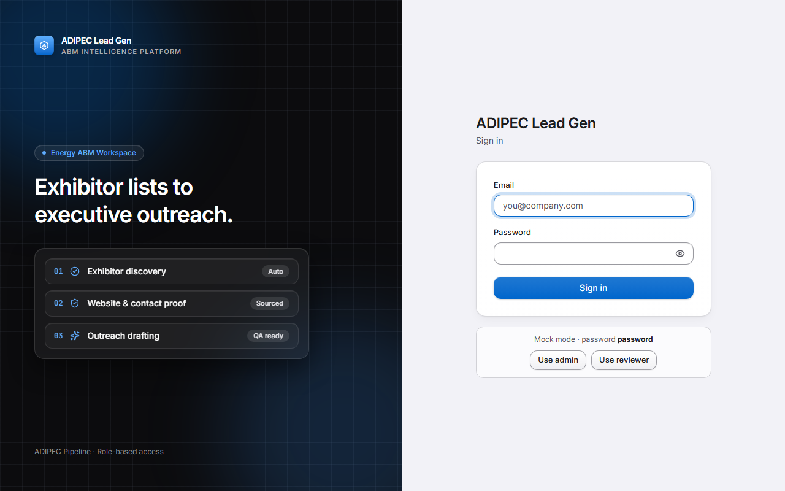
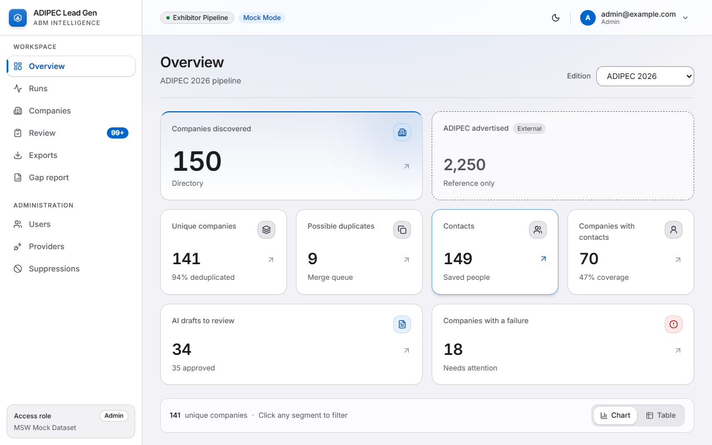
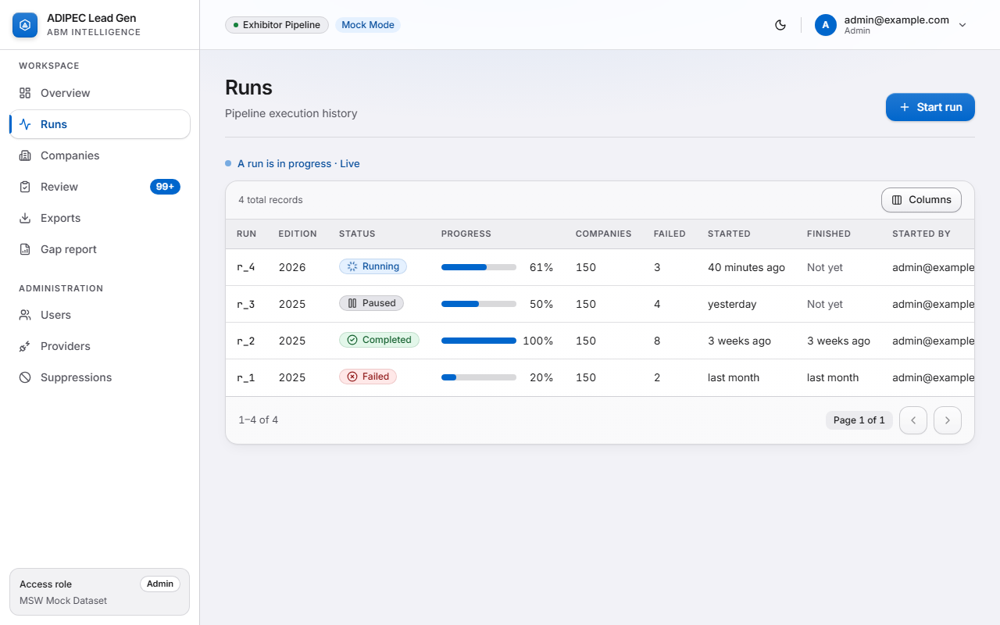
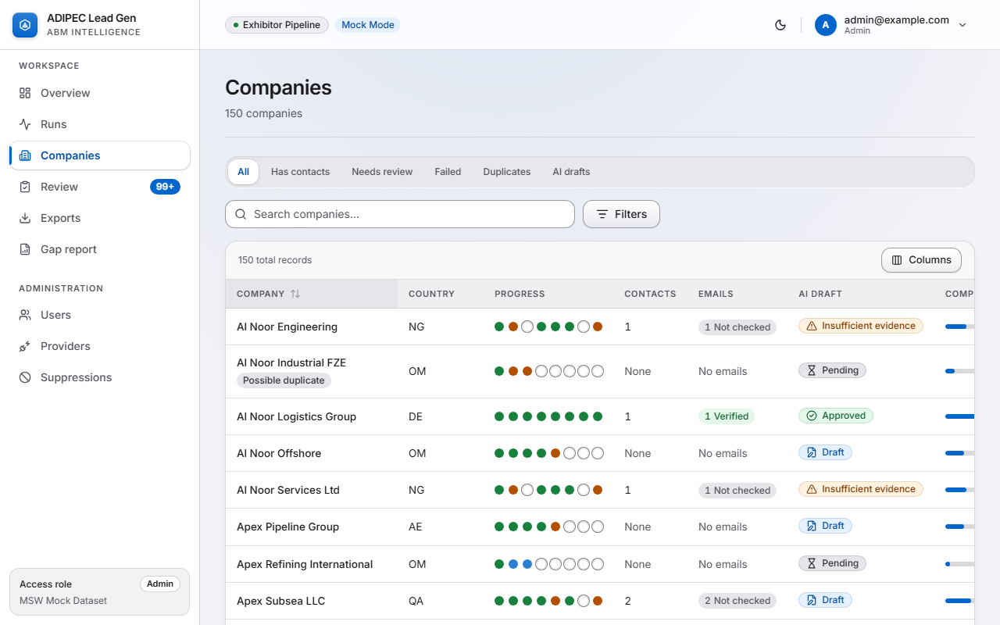
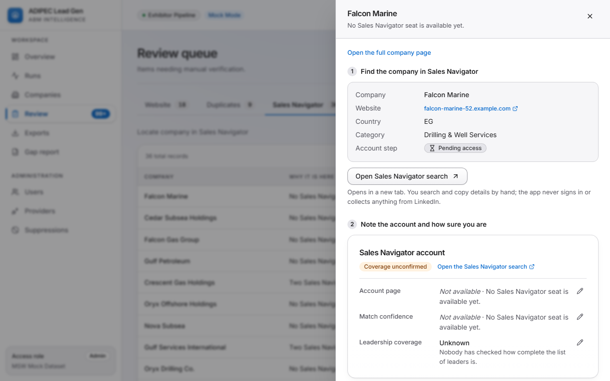
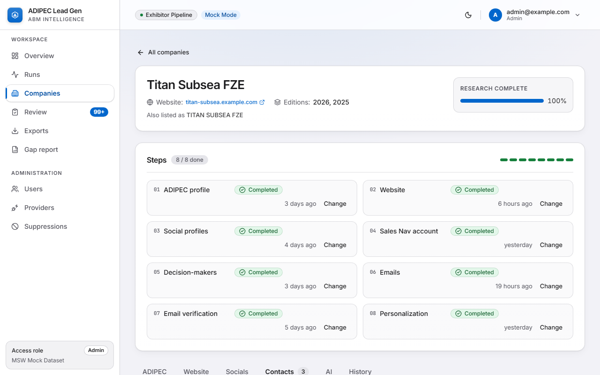
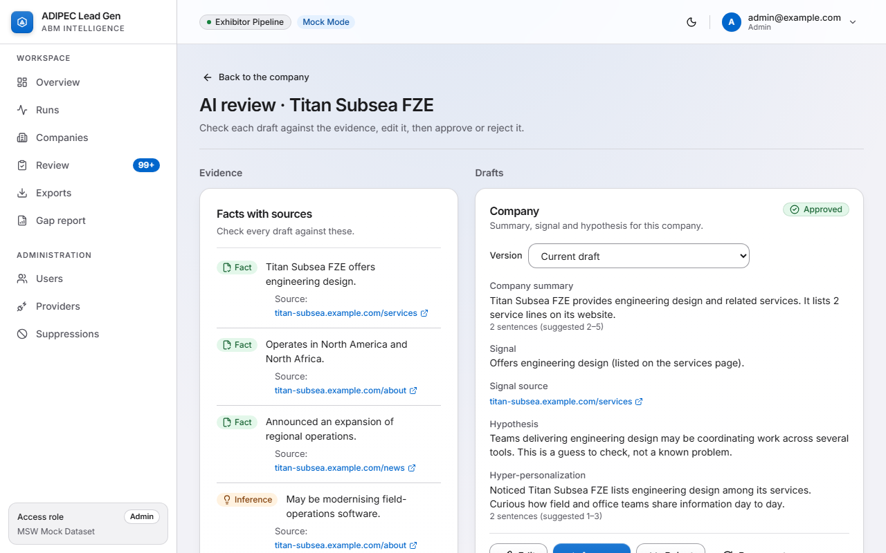
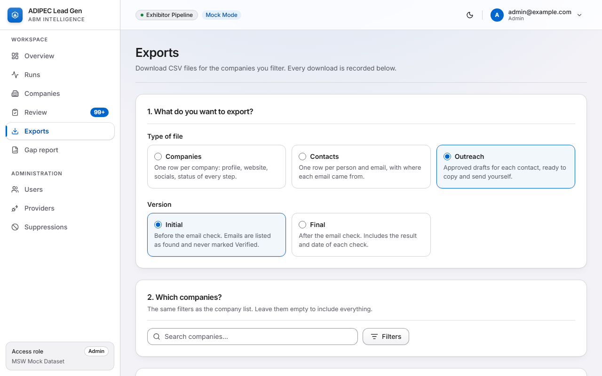
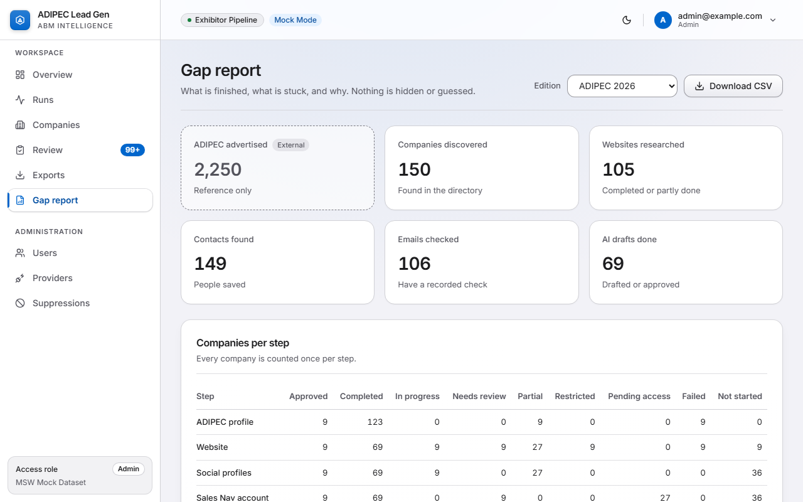
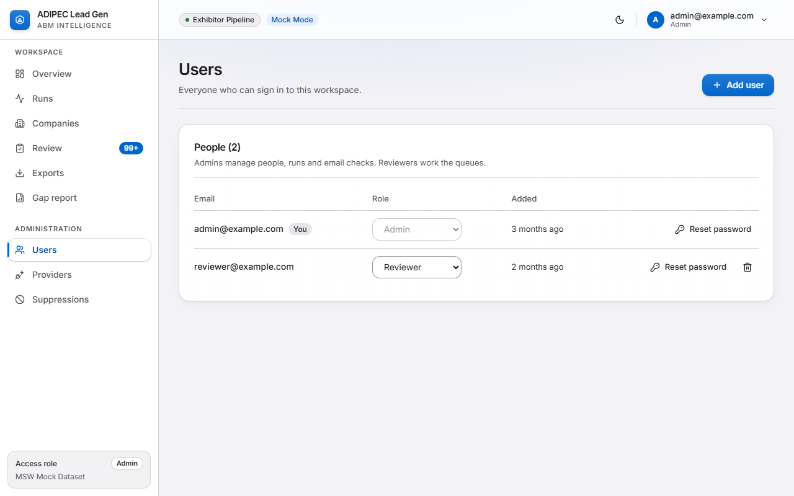

# User guide

For the people who use the ADIPEC Lead Generation workspace every day. No technical knowledge is
needed. If you can use email and a spreadsheet, you can do everything here.

**Contents**

1. [The ground rules](#1-the-ground-rules)
2. [Signing in and who can do what](#2-signing-in-and-who-can-do-what)
3. [Finding your way around](#3-finding-your-way-around)
4. [Start a run](#4-start-a-run-admin)
5. [Look up a company](#5-look-up-a-company)
6. [Work the review queue](#6-work-the-review-queue)
7. [Do the Sales Navigator task](#7-do-the-sales-navigator-task)
8. [Add contacts and import a CSV](#8-add-contacts-and-import-a-csv)
9. [Review the AI drafts](#9-review-the-ai-drafts)
10. [Export, check emails, export again](#10-export-check-emails-export-again)
11. [The gap report](#11-the-gap-report)
12. [Admin screens](#12-admin-screens)
13. [What every status means](#13-what-every-status-means)
14. [If something looks wrong](#14-if-something-looks-wrong)

---

## 1. The ground rules

These are built into the workspace. Knowing them explains why some things work the way they do.

- **Nothing is invented.** Every fact shows where it came from. When something is missing, the
  screen says **Not available** and gives the reason. It never fills a gap with a guess.
- **Sales Navigator is always done by you.** The workspace only links to it. It never signs in,
  searches or copies anything from LinkedIn for you.
- **Nothing is sent automatically.** The AI writes drafts. You read, edit and approve them, and you
  copy and send them yourself.
- **An email is only "Verified" after a real check.** A new email is **Not checked**. Never assume
  it works.
- **No company is ever dropped.** A company with no website, no contacts or no emails is still a
  valid record. It just shows what is missing.
- **Everything you change is recorded.** The **History** tab of each company shows what changed,
  from what to what, who did it and when.

## 2. Signing in and who can do what

Sign in with the email and password an admin gave you. The page may take up to a minute to answer
the first time after a quiet period. A "waking up" banner appears, and it carries on by itself.

There are two roles:

| | Admin | Reviewer |
| --- | :---: | :---: |
| See everything, edit data, add contacts, work the review queue | Yes | Yes |
| Review and approve AI drafts, export files, see the gap report | Yes | Yes |
| Start, pause and resume runs | Yes | – |
| Delete a contact | Yes | – |
| Check emails (the verification run) | Yes | – |
| Users, Providers and Suppressions screens | Yes | – |

Things you are not allowed to do are hidden, not just greyed out.

## 3. Finding your way around

The menu on the left has everything:

- **Overview**: how far the work has got for one exhibition. Pick the edition at the top. Click any
  coloured segment to see exactly those companies.
- **Runs**: the automatic collection jobs.
- **Companies**: every company, with search and filters.
- **Review**: the work that needs a person. The number is how many items wait.
- **Exports**: download CSV files.
- **Gap report**: what is finished and what is stuck.
- **Users, Providers, Suppressions**: admins only.

Tips: hover over any coloured badge to see what it means. The moon icon at the top switches between
light and dark. On a small screen the menu opens with the menu button.

## 4. Start a run (admin)

A **run** is an automatic job that collects the exhibitor list and researches each company.

1. Open **Runs** and click **Start run**.
2. Choose the **edition** (the exhibition year).
3. Leave all the steps ticked to do everything, or untick the ones you do not want this time.
4. Click **Start run**.

You land on the run's page, where the bars fill up as it works. Only **one run can be active at a
time**. To start another, pause or wait for the current one. A paused run carries on where it
stopped when you resume it. If a company fails, the run carries on and the error is listed on the
run page. One failing company never stops the others.

## 5. Look up a company

Open **Companies**. Type in the search box or open **Filters** (country, category, step status,
email status, AI status and more). Click a column heading to sort. Your filters are kept in the
address, so you can copy the link and send it to a colleague. Click a row to open the company.

A company page has six tabs:

| Tab | What is there |
| --- | --- |
| **ADIPEC** | What ADIPEC published about the company, for each year it exhibited |
| **Website** | Summary, services, markets and sourced facts from the company's own site |
| **Socials** | LinkedIn, Facebook, Instagram, X, YouTube and other links |
| **Contacts** | The Sales Navigator account and the decision-makers you saved |
| **AI** | The drafts, with their status (read only; review them on the AI review page) |
| **History** | Every change: before, after, who and when |

**Editing.** Hover over a field and click the pencil. Press **Enter** to save or **Escape** to
cancel. The change shows at once. If the server refuses it, the old value comes back with a message.
A small padlock appears on a field you edited, which means automatic updates will not overwrite
it.

**Changing a step by hand.** The row of steps at the top shows how far each step has got. Use the small
**Change status** button next to a step to set it yourself. You must give a reason, because it is recorded in the history.

## 6. Work the review queue

The **Review** page has six tabs. Each lists the companies that need a person, why, and how long
they have waited. Click a row to open it in a side panel. Finish the item and it leaves the list.

| Tab | What you do |
| --- | --- |
| **Website** | Type the right website address, or mark the company as having no website (a reason is required) |
| **Duplicates** | Compare two records side by side, then merge them or say they are different |
| **Sales Navigator** | Do the Sales Navigator task (next section) |
| **Contacts** | Add a person, look in Sales Navigator, or record that none were found, with a reason |
| **Emails** | Correct, remove or add an email (a source is always required) |
| **AI drafts** | Open the AI review page for drafts that were rejected or had too little evidence |

When you merge duplicates you are asked to confirm and choose which record to keep. The contacts
move to the record you kept, and the merge is recorded in the history.

## 7. Do the Sales Navigator task

Open **Review → Sales Navigator** and click a company. The panel walks you through it:

1. **Find the company.** Check the facts shown, then click **Open Sales Navigator search**. It
   opens in a new tab. Search there yourself.
2. **Note the account.** Paste the company's Sales Navigator page address, say how sure you are it is
   the same company (high, medium or low), and set the **leadership coverage** (see below).
3. **Add the decision-makers** you found. Click **Add contact** and fill in the form. You stay in the
   panel.
4. **Finish** with **Mark account and people done**.

**Leadership coverage** says how complete your list of leaders is. Sales Navigator's relationship
explorer only shows a limited set of people. So choose **Reviewed** only if you checked beyond it.
Otherwise leave **Unknown**, or choose **Confirmed partial** if you know the list is incomplete. The
workspace never calls a list complete unless you said you reviewed it.

## 8. Add contacts and import a CSV

Open a company's **Contacts** tab.

**Add one person.** Click **Add contact**. First and last name are required. For each email, choose
**where you found it**. You cannot save an email without a source. The email starts as **Not
checked**. If you add a name that already exists on the company, the form tells you it will update
that person instead of adding a second one.

**Opt-outs.** If an email or its domain is on the opt-out list, it is refused with a message.

**Import many people at once.** Click **Import CSV**.

1. Click **Download template** for a file with the right column names. Fill it in a spreadsheet and
   save it as CSV.
2. Paste the rows into the box. The required columns are `first_name` and `last_name`. The others are
   `title`, `seniority`, `profile_url`, `geography` and `email`.
3. Check the preview (the first 10 rows), then click **Import**.

Good rows are saved even if others have problems. The result tells you how many were added and
updated, and a table lists each skipped row by number with the reason. Fix those rows and paste
only them again. Pasting the same person twice just updates them.

## 9. Review the AI drafts

Open a company's **AI** tab and click **Open AI review**, or open an item from **Review → AI
drafts**.

The left side is the **evidence**: facts with source links, services, and ADIPEC's description. The
right side has the **drafts**: one block for the company, then one for each contact (email subject,
email draft, LinkedIn message). Check each draft against the evidence.

For each block you can:

- **Edit** and **Save**. This creates a new version. Nothing is overwritten.
- **Approve** the draft. Only then does it count as the approved copy.
- **Reject** it. You must write a reason.
- **Regenerate** it to ask for a fresh draft. It shows "Generating…" until it is ready.
- Open the **Version** menu to look at an older version, and use it again if you want.

Good to know:

- The **approved copy** is shown in its own box with the date and who approved it. A new draft or
  regeneration never changes it. Exports use the approved copy until you approve a newer one.
- If a draft says **Insufficient evidence**, there were no sourced facts to write from, so nothing
  was written. You can write it yourself and save it, or add a source and regenerate. It cannot be
  approved empty.
- Every signal must have a **source link**. You cannot approve a signal without one.
- The length guides (for example "2–5 sentences") are suggestions. They never stop you saving.
- **Copy** buttons on the contact drafts help you paste into your own email or LinkedIn. The
  workspace sends nothing.

## 10. Export, check emails, export again

Open **Exports**. There are three steps:

1. **Choose the file.** *Companies* (one row per company), *Contacts* (one row per person and
   email), or *Outreach* (the approved drafts for each contact). Then choose the **version**:
   - **Initial**: before the email check. Emails are listed as found and are never marked Verified.
   - **Final**: after the email check. It includes the result and date of each check.
2. **Choose the companies.** These are the same filters as the company list. Leave them empty to
   include everything.
3. **Download.** The row count updates as you change the filters. If no rows match, the button
   is switched off. The file opens in Excel with correct characters.

Every download is listed under **Export history** with its filters and who made it.

**Checking the emails (admin).** Once an initial file has been downloaded, the **Check emails**
section lets an admin check every email that has never been checked.

1. Pick the edition and click **Check emails**.
2. Read the confirmation. If **MillionVerifier** is on, it names it. If it is off, the check can only
   look at each address's domain, and it **cannot mark any email as Verified**.
3. Click **Start the check**. Progress shows on the page. The check is a run, so you can also follow
   it under **Runs**.

When it finishes, download the **Final** version. It is switched off while another run is going,
because only one run can be active.

## 11. The gap report

**Gap report** shows, for one edition: how many companies were discovered, how many websites were
researched, how many contacts were found, how many emails were checked and how many AI drafts are
done. Below are the companies per step, and a list of every **blocked record** (failed, restricted,
or waiting for a person), with the reason and a link to the company. **Download CSV** saves the
blocked list. ADIPEC's advertised number is shown as a reference only. It is never compared with
what was found.

## 12. Admin screens

Only admins see these.

- **Users.** Add a person (email, password of at least 8 characters, and a role), change someone's
  role, reset a password, or delete a user. You cannot change or delete yourself.
- **Providers.** Shows which outside tools are on (ContactOut for finding emails, MillionVerifier
  for checking them, the language model for AI drafts). While one is off, the page says what the
  team does by hand. Switches are changed on the server, not here.
- **Suppressions.** The opt-out list. Add an email address or a whole domain, with an optional
  reason. Suppressed addresses cannot be saved as contacts. Remove an entry only if the person
  agreed to be contacted again.

## 13. What every status means

Hover over any badge in the workspace to see the same text.

**Steps** (the status of each stage for a company)

| Status | Meaning |
| --- | --- |
| Not started | This step has not run yet |
| In progress | This step is running now |
| Completed | This step finished |
| Partial | Only some of the data could be collected |
| Needs review | A person needs to check this |
| Pending access | Waiting for a tool or access we do not have yet |
| Restricted | The source does not allow automated access |
| Failed | This step failed. See the reason |
| Approved | A reviewer approved this |

**Emails**

| Status | Meaning |
| --- | --- |
| Verified | A permitted check confirmed this address can receive email |
| Risky | Catch-all or otherwise uncertain deliverability |
| Invalid | An approved check reported this address as invalid |
| Unknown | A check ran but could not tell if the address works |
| Not checked | No permitted check has been run. **This is not a verified address** |

**AI drafts**

| Status | Meaning |
| --- | --- |
| Pending | Not generated yet |
| Insufficient evidence | Not enough sourced facts to write this safely |
| Draft | Waiting for review |
| Approved | A reviewer approved this copy |
| Rejected | A reviewer rejected it, with a reason |

**Runs**

| Status | Meaning |
| --- | --- |
| Running | Working through the companies now |
| Paused | Stopped. Resume it to carry on where it left off |
| Completed | Every step has finished |
| Failed | Stopped because of an error. See the error list |

**Leadership coverage**

| Value | Meaning |
| --- | --- |
| Unknown | Nobody has checked how complete the list of leaders is |
| Confirmed partial | Some leaders are saved, and the list is known to be incomplete |
| Reviewed | A person looked beyond the limited relationship explorer panel |

## 14. If something looks wrong

- **"The server is waking up".** The service sleeps when nobody uses it. Wait up to a minute. The
  page retries on its own.
- **A message says a change was not saved and was undone.** The server refused it. The message says
  why. Fix that and try again.
- **A button is missing.** It is probably an admin action and you are a reviewer. Ask an admin.
- **A field says "Not available".** The reason is shown next to it. It means the information could
  not be found, not that something is broken.
- **A number on one page differs from another.** Check both are set to the same edition and the same
  filters. The gap report and the overview use the same numbers for the same edition.
- **Anything else.** Tell the developer which page you were on and what you clicked, and say what
  you expected to happen.
